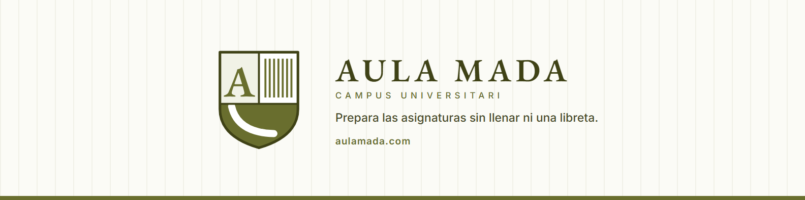

  

  <b>Apuntes, laboratorios interactivos, ejercicios resueltos y simulacros de examen para primero de universidad.</b> 
  Català · Castellano · English

  
  
  

---

### Qué es Aula Mada

Un campus para preparar las asignaturas de primero sin llenar ni una libreta. Cada tema tiene:

- **Apuntes en dos niveles:** *Directo*, para repasar rápido, y *Explicado*, paso a paso.
- **Laboratorios interactivos** para tocar los conceptos: mover un parámetro y ver qué cambia.
- **Práctica en tres niveles**, con ejercicios nuevos cada vez y la solución resuelta.
- **Simulacros con el formato del examen**, con reloj y descarga en PDF.
- **Repaso personalizado** de lo que más cuesta.

Todo el contenido es gratuito. El plan **Pro** añade un tutor con IA y la corrección de simulacros.

### Grados

| Disponible | Próximamente |
|---|---|
| Ingeniería Informática | Administración y Dirección de Empresas |
| Ingeniería en Tecnologías Industriales | Enfermería |
| Ciencia e Ingeniería de Datos | Magisterio |
| Historia | Física y Matemáticas · Ciencias Políticas |

El orden de los temas se adapta al plan de estudios de cada universidad.

### Asignaturas

Matemáticas · Lógica y grafos · Economía · Computadores · Programación (C++ y pseudocódigo) ·
Física · Estadística · Química · Arte e Historia · Arqueología · Antropología e Historia

### Apuntes públicos

[Català](https://aulamada.com/apunts/) · [Castellano](https://aulamada.com/apuntes/) · [English](https://aulamada.com/notes/)

---

   
  Proyecto independiente, sin vínculo con ninguna universidad.

